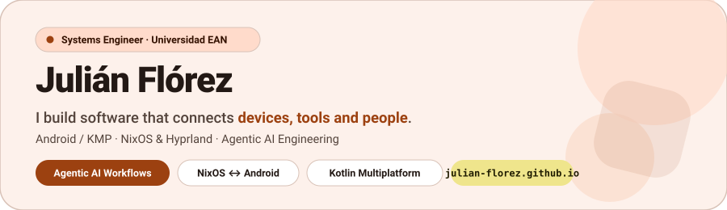
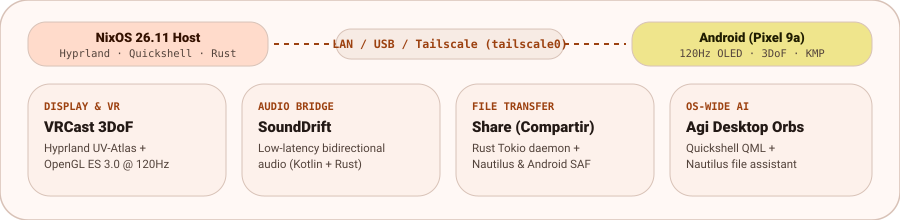

  <a href="https://julian-florez.github.io">
    <picture>
      <source media="(prefers-color-scheme: dark)" srcset="./assets/hero-dark.svg" />
      <source media="(prefers-color-scheme: light)" srcset="./assets/hero-light.svg" />
      
    </picture>
  </a>

    

  
  
  

---

### How I Build Software

I am a **Systems Engineering student at Universidad EAN** building software across **Android / Kotlin Multiplatform**, **NixOS / Linux**, and **Agentic AI**.

Instead of using coding agents for isolated snippets, I design **multi-agent workflows** (`AGENTS.md`, specialized subagents, MCP toolchains, and automated verification loops) across **Codex**, **OpenCode**, and **Antigravity** to ship full systems faster without sacrificing architecture.

- **Human Architect Decisions:** system boundaries, network protocols, failsafes, and UX craft (**Material Design 3 Expressive**).
- **Agent Execution:** parallel implementation across host daemons, mobile clients, and documentation sync.
- **Verification Loop:** Gradle/Cargo/Python builds, `pytest` suites, GLSL shader checks, and live device testing.

---

### The NixOS ↔ Android Ecosystem

A self-built personal computing bridge connecting my **NixOS + Hyprland** laptop and **Google Pixel 9a** over LAN, USB, and **Tailscale (`tailscale0`)**:

  <a href="https://julian-florez.github.io/#ecosystem">
    <picture>
      <source media="(prefers-color-scheme: dark)" srcset="./assets/ecosystem-dark.svg" />
      <source media="(prefers-color-scheme: light)" srcset="./assets/ecosystem-light.svg" />
      
    </picture>
  </a>

---

### Selected Projects

| Project | Domain | Highlights | Link |
| :--- | :--- | :--- | :--- |
| **VRCast 3DoF** | `Systems · VR` | 120Hz 3DoF Spatial VR Desktop over Hyprland `HEADLESS-1` UV-Atlas, Sunshine & OpenGL ES 3.0 | [Case Study](https://julian-florez.github.io/#cases) |
| **Agi** | `Agentic AI · Wayland` | Unified desktop agent harness with floating pure orbs in Quickshell QML & Nautilus (`_agente.py`) | [Case Study](https://julian-florez.github.io/#cases) |
| **Win2APK** | `Systems · Thesis` | Undergraduate thesis packaging Windows apps into Android APKs (built across 77 Codex sessions) | [Repository](https://github.com/Julian-Florez/Win2APK) |
| **CareerOS** | `Agentic AI · Full-Stack` | Multi-agent career & job platform with Python 3.12, SQLite, Typst CV compiler & Nix Flake | [Case Study](https://julian-florez.github.io/#cases) |
| **Share (Compartir)** | `Rust · Android` | P2P file transfer with Rust/Tokio daemon, Nautilus picker & Android Share Sheet / SAF | [Case Study](https://julian-florez.github.io/#cases) |
| **Cinema & Material Suite** | `KMP · Material 3` | Cross-platform apps (`Cinema`, `MaterialTextEditor`, `MaterialCalendar`, `MaterialTasks`) | [MaterialTextEditor](https://github.com/Julian-Florez/MaterialTextEditor) |
| **SoundDrift** | `Audio · Kotlin / JS` | Real-time, low-latency audio streaming between Android and Desktop | [Repository](https://github.com/Julian-Florez/SoundDrift) |
| **KMP Arcade** | `KMP Web · Games` | Playable Material 3 versions of Tetris, Snake & 2048 compiled for Web, Desktop & Android | [Play Live](https://julian-florez.github.io/#arcade) |

---

### Core Stack

- **Mobile & UI:** Kotlin, Kotlin Multiplatform (KMP), Jetpack Compose, Material Design 3 Expressive, OpenGL ES 3.0 / GLSL
- **Systems & Infra:** NixOS (Flakes), Linux Administration, Hyprland (Wayland), Quickshell (QML), Rust (Tokio), C, Tailscale
- **Agentic AI & Backend:** Python 3.12, Codex CLI, OpenCode, Antigravity, SQLite, Typst, TypeScript / Astro

---

  Explore interactive case studies, architecture diagrams, and playable KMP demos at <a href="https://julian-florez.github.io"><b>julian-florez.github.io</b></a>

